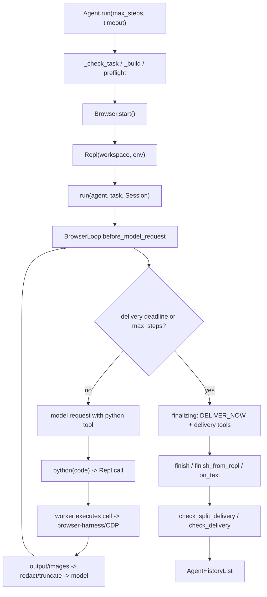
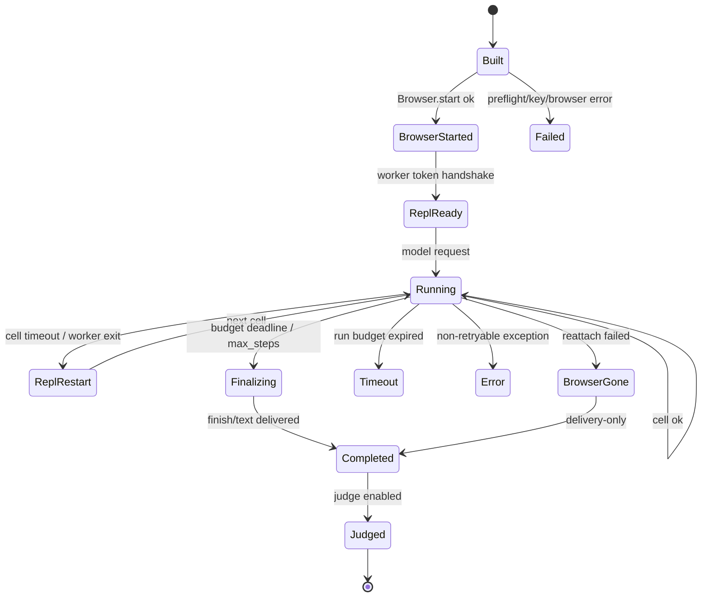
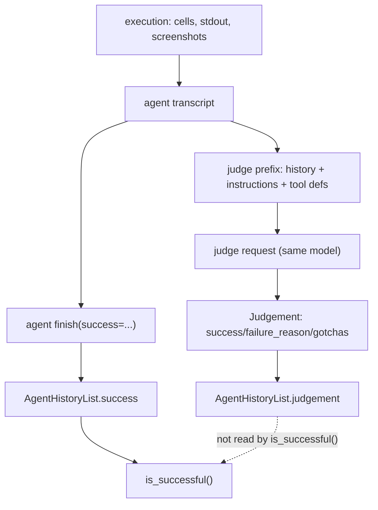
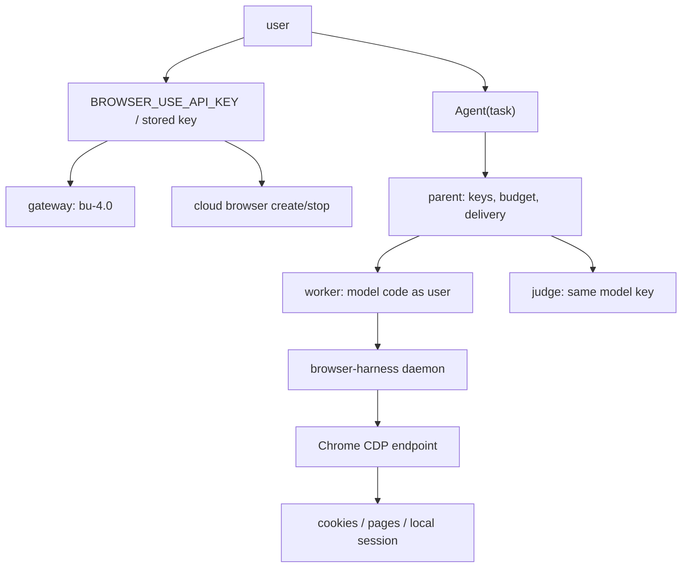
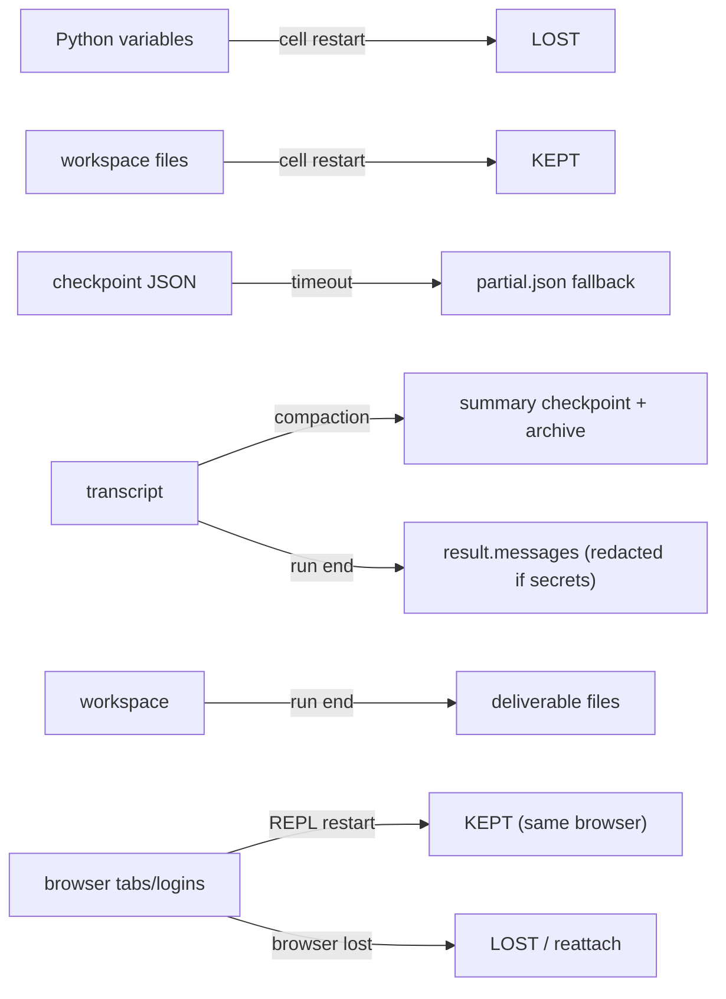
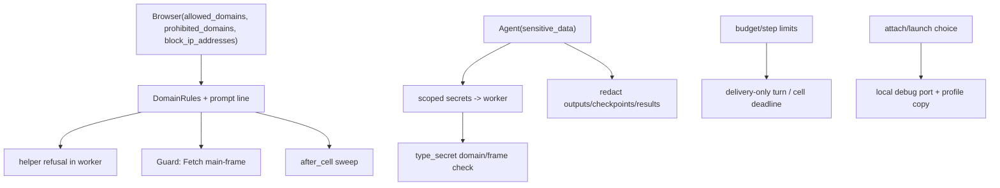

# 04 Flow Atlas — browser-use 1.0.8

Flows are derived from real symbols and conditions, not from the README. Each edge lists a source symbol, the condition that activates it, and the state change it causes. Edge IDs are stable for this run.

## 1. Control Flow (CF)

**Purpose**: how a task becomes a sequence of model requests, Python cells, and a delivery.

| Edge | From → To | Trigger/condition | Evidence |
|---|---|---|---|
| CF-01 | `Agent.run` → `_build` | every run; rejects overlapping `_running`/`browser._user` | `agent/service.py:452-475` |
| CF-02 | `_build` → `Browser.start` | model resolved and preflight passed | `agent/service.py:380-475` |
| CF-03 | `Browser.start` → `Repl` | browser env returned; REPL recreated if env changed | `agent/service.py:520-560` |
| CF-04 | `run` → `BrowserLoop.before_model_request` | every model request | `agent/loop.py:426-455` |
| CF-05 | `before_model_request` → finalizing | `run_step >= max_steps` or `elapsed >= delivery_at()` | `agent/loop.py:440-470` |
| CF-06 | model → `python` | model emits a `python` tool call | `agent/loop.py:178-220` |
| CF-07 | `python` → worker | `Repl.call('exec', code, min(cell_timeout, left))` | `agent/loop.py:190-210`; `repl/session.py:480-520` |
| CF-08 | worker → model | cell output, error, images returned and redacted | `agent/loop.py:200-220`; `repl/session.py:520-560` |
| CF-09 | finalizing → delivery | forced `finish`/`finish_from_repl` or unforced delivery-only tools | `agent/loop.py:426-470`, `1023-1043` |
| CF-10 | delivery → result | `check_split_delivery`, `check_delivery`, schema validation | `agent/loop.py:226-405` |
| CF-11 | result → judge | `judge=True and result.steps`; after browser shutdown | `agent/service.py:600-656` |

**Failure branches**: `UsageLimitExceeded` → `status=max_steps`; `TimeoutError` from the run budget → `status=timeout`; other exceptions → `status=error`; browser lost → `browser_gone` and next turn delivery-only.

## 2. State Flow (SF)

**Purpose**: how run, worker, and browser states change independently.

| Edge | State transition | Condition | Evidence |
|---|---|---|---|
| SF-01 | Built → BrowserStarted | `Browser.start()` returns env | `agent/service.py:520-545` |
| SF-02 | BrowserStarted → ReplReady | worker connects with valid token within 60 s | `repl/session.py:357-435` |
| SF-03 | Running → ReplRestart | cell timeout or worker exit | `repl/session.py:524-560` |
| SF-04 | ReplRestart → Running | next `Repl.call` sees no process and calls `start()` | `repl/session.py:480-500` |
| SF-05 | Running → Finalizing | `before_model_request` budget check | `agent/loop.py:440-470` |
| SF-06 | Finalizing → Completed | delivery tool/text passes checks | `agent/loop.py:336-405` |
| SF-07 | Running → Timeout | `asyncio.timeout(session.timeout_s)` fires | `agent/loop.py:1301-1340` |
| SF-08 | Running → BrowserGone | `BrowserConnectionLost` and reattach fails | `repl/session.py:520-550` |
| SF-09 | Completed → Judged | `self.judge and result.steps` | `agent/service.py:628-656` |

**Key state invariants**:
- `status != completed` forces `success=None` (`views.py:105-120`).
- `finalizing` is one-way; it is set, never cleared.
- `checked_delivery` gates the repair to one attempt.
- `split_delivery_step` records the one split-delivery repair.
- `browser_gone` forces the next turn to delivery-only.

## 3. Data Flow (DF)

**Purpose**: how task/page bytes become model context and a delivered artifact.

```mermaid
flowchart LR
  T["task text"] --> R["redact(task, secrets)"]
  R --> P["system prompt + task"]
  P --> M["model request"]
  M --> C["Python code"]
  C --> W["worker namespace"]
  W --> H["browser-harness helpers / cdp()"]
  H --> B["browser page"]
  B --> O["stdout / stderr / screenshot / return value"]
  O --> X["redacting pump + Repl.call redact"]
  X --> L["12k char clip + image BinaryContent"]
  L --> M
  L --> F["finish_from_repl / checkpoint"]
  F --> D["result.text / result.output / files"]
```

| Edge | Data | Transformation | Evidence |
|---|---|---|---|
| DF-01 | task → prompt | `redact(task, secrets)` before model sees it | `agent/service.py:520-560`, `loop.py:1301-1340` |
| DF-02 | model → code | tool-call argument, no schema beyond a string | `agent/loop.py:178-220` |
| DF-03 | code → page | browser-harness helper or raw `cdp()` | `repl/worker.py:494-728` |
| DF-04 | page → output | stdout/stderr, screenshots, return values | `repl/worker.py:1142-1200` |
| DF-05 | output → file | `_pump` redacts incrementally into `cells/<n>.txt` | `repl/worker.py:1016-1034` |
| DF-06 | output → model | `MAX_OUTPUT_CHARS=12_000`; images as `BinaryContent` | `repl/session.py:30-40`; `agent/loop.py:200-220` |
| DF-07 | value → delivery | `finish_from_repl` evals, schema-validates, redacts fields | `agent/loop.py:336-405` |
| DF-08 | value → disk | `checkpoint` atomic JSON, redacted | `repl/worker.py:742-751` |

**Boundary**: page bytes are not structurally parsed. The model chooses what to print; a `js()` call can return a whole DOM or a single field. Observability is model-authored, not serializer-authored.

## 4. Evidence Flow (EF)

**Purpose**: what counts as evidence for the run’s verdict, and where it travels.

| Edge | Evidence movement | Condition | Evidence |
|---|---|---|---|
| EF-01 | execution → transcript | every tool return is appended to messages | `agent/loop.py:178-220`; Pydantic AI message list |
| EF-02 | transcript → judge | `judge_cached` uses history + instructions + tool defs | `agent/judge.py:200-276` |
| EF-03 | transcript → judge fallback | cached judge calls a tool or returns no JSON | `agent/judge.py:260-276` |
| EF-04 | execution → judge images | last 4 distinct tool images + final page | `agent/judge.py:75-135` |
| EF-05 | agent verdict → result | `finish(success=...)`, `status==completed` | `agent/loop.py:389-400`; `views.py:105-120` |
| EF-06 | judge verdict → result | `result.judgement` only; no merge with `success` | `agent/service.py:628-656` |
| EF-07 | agent verdict → `is_successful()` | returns `self.success` only | `views.py:145-150` |
| EF-08 | judge verdict → `is_successful()` | **no edge**: `judgement` is not read | `views.py:105-150` |

**Evidence gap**: the judge sees the agent’s trace and final-page screenshot, not an independent execution. It cannot verify that a claimed value was observed in the session except by reading the trace. The prompt forbids treating the agent’s claim as proof, but the trace itself is the only evidence channel.

## 5. Authority Flow (AF)

**Purpose**: who can do what to the browser, the model, and the host.

| Edge | Authority | Constraint | Evidence |
|---|---|---|---|
| AF-01 | user → API key | env or stored browser-harness key; key never sent to worker | `auth.py:76-150`; `repl/session.py:42-88` |
| AF-02 | API key → gateway model | `bu-4.0` default; one key for model + cloud | `llm/__init__.py:33`, `165-210` |
| AF-03 | parent → worker | allowlisted env, token-authenticated loopback, user UID | `repl/session.py:357-435` |
| AF-04 | worker → daemon | browser-harness helpers; `BH_REQUIRE_EXISTING_DAEMON=1` prevents naive discovery | `repl/session.py:395-410` |
| AF-05 | daemon → Chrome | local WebSocket or cloud CDP; no per-request auth on local endpoint | `browser/browser.py:899-999`; `local.py:104-145` |
| AF-06 | worker → host files | user-readable files, parent `.env`, `/proc` | `MIGRATING.md`; `tests/ci/test_repl.py:121-128` |
| AF-07 | parent → judge | same model/key, separate request, redacted text, unredacted screenshots | `agent/judge.py:130-190` |

**Authority concentration**: the API key is both model credential and cloud-browser credential. The cloud live-view URL is a separate bearer capability. The local debug port is a third, unauthenticated capability.

## 6. Memory Flow (MF)

**Purpose**: what survives a cell, a worker restart, a compaction, and a run.

| Edge | Memory movement | Condition | Evidence |
|---|---|---|---|
| MF-01 | variables → lost | worker timeout/exit; new worker has empty namespace | `repl/session.py:524-560`; `worker.py:1142-1200` |
| MF-02 | files → kept | workspace is cwd, files survive worker restart | `repl/session.py:31`; `worker.py:109-120` |
| MF-03 | checkpoint → partial fallback | `checkpoint(..., partial=True)` writes `partial.json` | `worker.py:742-751`; `loop.py:166-175` |
| MF-04 | transcript → summary checkpoint | client-side compaction threshold met | `loop.py:772-900` |
| MF-05 | transcript → archive | `_compact` writes `context/<uuid>.json` 0700/0600 | `loop.py:900-1000` |
| MF-06 | transcript → result.messages | end of run; redacted only if secrets exist | `loop.py:1355-1370` |
| MF-07 | browser state → kept | REPL restart with same browser env | `repl/session.py:520-545` |
| MF-08 | browser state → lost | reattach fails; new browser | `repl/session.py:530-550` |

**Memory asymmetry**: the design deliberately preserves artifacts over Python state. A model that keeps a critical value only in a variable loses it on a timeout; a model that checkpoints it can recover it.

## 7. Policy Flow (PF)

**Purpose**: where policy is decided and where it is enforced.

| Edge | Policy | Enforcement point | Bypass/exception | Evidence |
|---|---|---|---|---|
| PF-01 | domain allowlist | prompt line + helper refusal + Guard + sweep | subresources, iframes, Python HTTP, speculation/bfcache | `domains.py:1-24`, `281-455`; `worker.py:544-550` |
| PF-02 | prohibited domains | same as PF-01; ignored when allowlist set | allowlist precedence | `domains.py:198-280` |
| PF-03 | block IP literals | before pattern match | hostnames that resolve to IPs are not blocked | `domains.py:198-280` |
| PF-04 | secret domain scope | `type_secret` focused-frame URL | frame race; unknown frame fails closed | `worker.py:840-897` |
| PF-05 | secret redaction | output/checkpoint/result channels | screenshots, `js()`, self-written files, arbitrary transforms | `session.py:135-200`; `MIGRATING.md` |
| PF-06 | budget | cell deadline + delivery turn + request limit | browser start/stop outside budget; uninterruptible cell | `loop.py:128-220`, `1301-1340` |
| PF-07 | browser attach | `require_debug_port`, `_check_one_chrome`, runtime dir 0700 | no auth on DevTools endpoint; any local user can connect | `local.py:104-156`; `browser.py:420-487` |
| PF-08 | cloud authority | API key + live-view URL | URL is bearer; no per-viewer auth | `browser.py:1000-1125`; `README.md` |

**Policy conclusion (fact, not principle)**: every policy in this project has an explicit scope and an explicit non-scope. The code and docs are unusually honest about the non-scope; the risk is that a reader collapses “guard” or “redaction” into “sandbox”.
